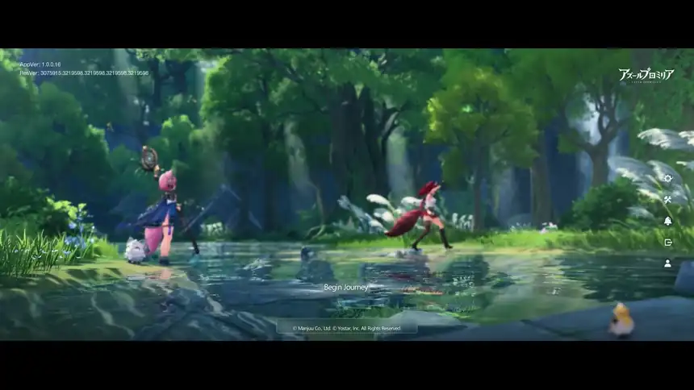

# Game Translation HUD

English drawn right over a Japanese game's own text while you play. The app reads the
screen, finds each line in a translation database and paints the translation in its place:
menus, buttons, popups and dialogue. Made for **Azur Promilia (JP)**.

<p align="center">
  
</p>

## Downloads

1. **[The app](https://github.com/ph1-st/game-translation-hud/releases/latest)**: Windows
   10/11. Unzip it and start `GameTranslationHUD.exe`.
2. **[The Azur Promilia (JP) English database](https://drive.google.com/drive/folders/1kxJOPALzPs-75gMVhur73Qwe-cMIgiDE?usp=sharing)**:
   every line of the game's text. You don't need to download it yourself: the app fetches
   it from this link.

## How to use it

1. Start the app and pick **Azur Promilia**, and the language you read.
2. Press **Download** to get the database from its link, or **Use a file…** for one you
   have. A file that isn't a translation database is refused, and the app tells you when
   the link has a newer one.
3. Press **Play**, then start the game (windowed or borderless). The translations appear
   on their own.

In the panel at the side of the screen you can switch menus and dialogue on or off, choose
how dialogue is shown, turn on live translation, and pick the text reader.
<kbd>Ctrl</kbd>+<kbd>Shift</kbd>+<kbd>F8</kbd> hides the translations.

## Text the database doesn't have

Turn on **Live translation**:

- **PLaMo, on your computer**: free and private. One click installs it once you've
  accepted its license; on a graphics card a line takes about a tenth of a second.
- **Claude** or **ChatGPT** with your own API key, if you prefer.

Only text is ever sent, never pictures, and PLaMo sends nothing at all.

## Faster on NVIDIA

**Text reader → MeikiOCR (NVIDIA, faster)** reads the screen about twice as fast with a
reader made for Japanese game text. It needs an NVIDIA graphics card and a one-time
download of about 1.9 GB (NVIDIA's CUDA libraries and the reader), which the app asks
before fetching. Other graphics cards use the standard reader.

## What it does and doesn't do

The app only looks at the screen and draws its own see-through window on top. It doesn't
modify the game, read or write its memory, hook its process or send it input, so use it at
your own discretion: a game's terms of service may still say something about third-party
tools. Everything is in this repository: the release builds are made by GitHub from it,
with SHA-256 checksums and a build attestation you can check
(`gh attestation verify <file> -R ph1-st/game-translation-hud`), and
[PRIVACY.md](PRIVACY.md) lists every connection the app makes.

More: [Guide](docs/USER_GUIDE.md) · [Guía en español](docs/USER_GUIDE.es.md) ·
[How it works](docs/ARCHITECTURE.md) · [Contributing](CONTRIBUTING.md)

## Building from source

```
uv sync --extra dev
uv run python -m app        # run the app
uv run pytest               # the tests
```

Packaging is in `packaging/`.

## Licence and credits

[MIT](LICENSE). Built with PLaMo: live translation can use
[PLaMo 3 Translate](https://huggingface.co/pfnet/plamo-3-translate-2b) by Preferred
Networks, under the
[PLaMo Community License](https://plamo.preferredai.jp/info/plamo-community-license-en),
run by [llama.cpp](https://github.com/ggml-org/llama.cpp). The screen is read by
[RapidOCR](https://github.com/RapidAI/RapidOCR) or by [MeikiOCR](https://github.com/rtr46/meikiocr)'s
models (LGPL-3.0) on ONNX Runtime's CUDA build. PLaMo and MeikiOCR are downloaded only when
you install them.
