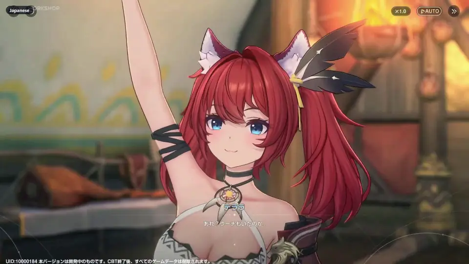
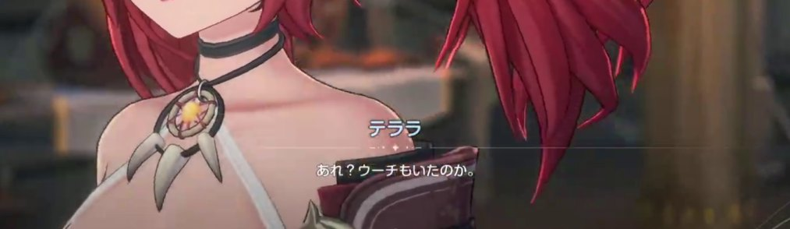
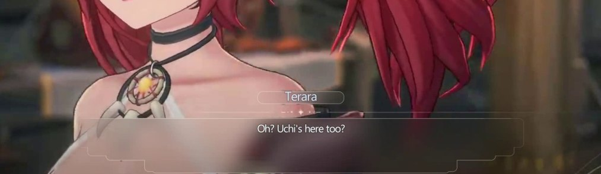
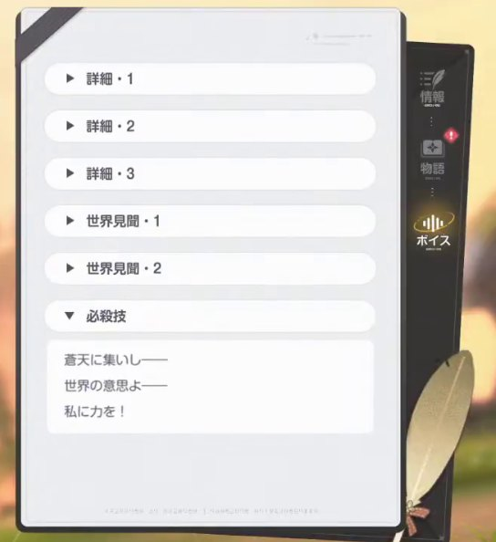
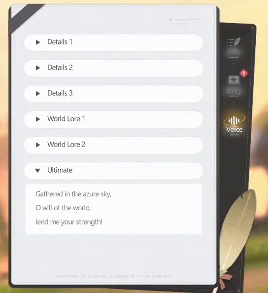
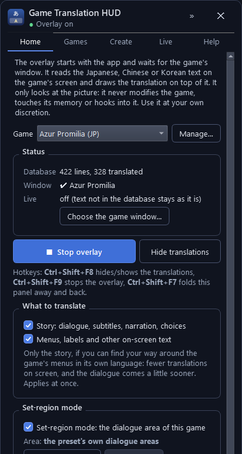

# Game Translation HUD

**Play Chinese, Japanese and Korean games in your language.** Add any game, get its
translation database (create it from the game's own files with an AI, or download one
someone shared), and play: the HUD reads the text in the game's picture, finds each line
in the database and draws the translation where the original was. It never changes the
game or touches its memory.

The pictures and the video show **Azur Promilia**, a game the app has a built-in preset
for. Every other game works the same way; you add it yourself.

  

**[⬇ Download the latest version](../../releases/latest)** · Windows 10 (version 2004) or 11 ·
a DirectX 12 graphics card · the game in windowed or borderless mode ·
**[▶ Tutorial video](../../releases/latest)** (2 minutes, every part of the app)

---

## What you'll see

| Original | With the HUD |
|:---:|:---:|
|  |  |
|  |  |

- **Story:** dialogue sits on soft frosted glass where the original was, and the
  translation types out with the line.
- **Menus:** labels and item names are painted over in place, in the game's own colours, with
  no boxes around them.
- A slightly faded line is a live translation (see [No database?](#no-database-translate-live)).
  Text the database doesn't know yet stays as it is.

## Set up

1. **Unzip and start the app.** Download the zip from
   [Releases](../../releases/latest), unzip it anywhere and keep the folder together. Start
   `GameTranslationHUD.exe`. If Windows says *"Windows protected your PC"*, click
   **More info**, then **Run anyway** (the app isn't code-signed yet).
2. **Set the game to windowed or borderless.** Exclusive full screen hides every overlay.
   Borderless windowed looks the same and leaves room for the HUD.
3. **Add your game.** The app's panel opens on the right edge of the screen. On the
   **Games** tab press **Add game…**: pick its window, the language its text is in
   (**Detect** reads it off the screen: Japanese, Chinese or Korean) and the folder it is
   installed in.
   - **Azur Promilia** is a built-in **preset**: its window, dialogue and menu areas are
     set.
   - **Every other game** is added as **Any other game**: then show the app its dialogue
     box ([set-region mode](#the-dialogue-area-set-region-mode)).
4. **Get its translation database** (one file per game, in the language you want):
   - **Create it** from the game's files ([below](#create-a-database)), or
   - **download one someone shared**: paste the link on the Games tab and press
     **Download** ([Sharing](#sharing-a-database)), or use a database file you have.
   - No database at all? [Translate live](#no-database-translate-live).
5. **Play.** Fold the panel away with **»** or <kbd>Ctrl</kbd>+<kbd>Shift</kbd>+<kbd>F7</kbd>.
   A small handle stays on the screen's edge: click it to bring the panel back.

 

## Create a database

On the **Create** tab, point the app at the folder the game is installed in and press
**Find the text**: it reads every line from the game's files (Unity, RPG Maker, Ren'Py,
KiriKiri / TyranoScript and plain-text games; the files are only read, never changed).
Choose the language to translate into, connect Claude with your own API key (the tab shows
how, and works out the cost first), and press **Create database**: it reads the story,
writes a lore bible, names the characters and terms, then translates every line in
context. You can pause at any time and go on later. Games that keep their text encrypted
can't be read; for them, *scrape mode* writes down every text while you play.

## Sharing a database

A database is one `.sqlite` file. To share yours, press **Share…** (or *Export the
database…*), upload the file to Google Drive and share it **read-only** (*Anyone with the
link* → *Viewer*). Anyone you give the link to pastes it on their Games tab and presses
**Download**. Dropbox, OneDrive, GitHub and direct links work too. When you have a new
version, upload it in place of the old one (Drive: *Manage versions*): the same link gets
it.

**Only use links from people you trust.** The app is careful with what comes in:

- **It asks first.** When a link has a newer version, the app asks you at start (*Download
  it* / *Not now*). A database is never downloaded or replaced by itself.
- **It checks every file before using it.** It must be a translation database: an SQLite
  file of at most 1 GB, with a table of lines that reads back without a single damaged
  page. Then only its text and numbers are copied into a fresh database of the app's own.
  Nothing in a database is ever run.
- **Your copy is kept** as a backup, and the lines you translated live stay.

## The dialogue area (set-region mode)

Story text gets frosted glass in the game's dialogue area. Azur Promilia's preset has its
areas set. For any other game (an RPG Maker game, a visual novel…) press **Choose the
area…** on the Home tab with a conversation on screen and drag a box over the dialogue box.
Choose whether the glass **grows with the text** or is **one window over the whole area**,
whether it **stays on screen**, and whether the translation **types in** like the game's
text or is there at once.

## No database? Translate live

Text that isn't in the database can be translated as it appears; with no database at all,
everything on screen is. On the **Live** tab (off by default) choose **DeepL**: a free
*DeepL API Free* key covers 500,000 characters a month at no cost. Google Cloud
Translation, Claude (the best for story: it follows the conversation; you pay Anthropic for
what you use) and a free model on your own PC through [Ollama](https://ollama.com) (it uses
your graphics card) work too. Live lines show slightly faded and are kept in the game's
database, so next time they appear at once. Only text is sent, never pictures.

## While you play

| Keys | What they do |
|---|---|
| <kbd>Ctrl</kbd>+<kbd>Shift</kbd>+<kbd>F8</kbd> | Hide or show the translations (a quick look at the original) |
| <kbd>Ctrl</kbd>+<kbd>Shift</kbd>+<kbd>F7</kbd> | Fold the panel away, or bring it back |
| <kbd>Ctrl</kbd>+<kbd>Shift</kbd>+<kbd>F9</kbd> | Stop the overlay |

The keys work while the game has the focus. Change them on the Home tab, under **Hotkeys**:
click one and press the new keys.

The dot next to the app's name shows the overlay's state: **green** on, **yellow** starting,
waiting for the game or translations hidden, **grey** off, **red** scrape mode, **orange**
something keeps it from working (the panel's message line says what).

**Only want the story?** On the Home tab, under **What to translate**, untick **Menus,
labels and other on-screen text**. Dialogue, subtitles, narration and your choices are
translated; the menus stay in the game's language.

## How it works

1. **Look.** The HUD captures the game window about 30 times a second. It never sees its
   own overlay or the panel: both hide from screen capture.
2. **Read.** A text reader on your graphics card reads only the parts of the picture that
   changed.
3. **Look up.** Every line is found in the translation database, even when a character or
   two is misread.
4. **Cover.** The translation is drawn on frosted glass for dialogue, painted in place for
   menus. It goes the moment the original goes.

The translations are made ahead of time, in story order with the game's names and terms as
context. That's why dialogue appears within a fraction of a second. A menu you open for the
first time takes about half a second to a second; after that it's instant.

## If something's off

- **Nothing appears over the game.** Check the Home tab's status: is the game window found?
  The game must be in windowed or borderless mode and not minimised.
- **The dot is orange.** Read the panel's message line. It names the cause: exclusive full
  screen, a screen that can't be captured, or a Windows version that's too old.
- **A hotkey does nothing.** Another program has it. Choose other keys on the Home tab.
- **Some text stays untranslated.** It isn't in the database yet. Switch on live
  translation, or add to the database.
- **The panel is gone.** Press <kbd>Ctrl</kbd>+<kbd>Shift</kbd>+<kbd>F7</kbd>, click the
  tray icon (Windows 11 tucks it under **^** next to the clock), or start the app again.
- **Start over.** Your settings, databases and logs are in
  `%LOCALAPPDATA%\GameTranslationHUD`. Close the app and delete that folder.

The app's **Help** tab has the full guide.

---

Game Translation HUD reads the screen and draws its own window. It doesn't modify the
game, touch its memory or hook the process; the Create tab only reads a game's files to
collect its text. Use it at your own discretion: a game's terms of service may still say
something about third-party tools.

Free to use, [MIT licence](LICENSE). The software it bundles keeps its own licences (see
`THIRD_PARTY_NOTICES.txt` in the download). Pictures and video: Azur Promilia closed beta,
from the RiverV Workshop stream.
