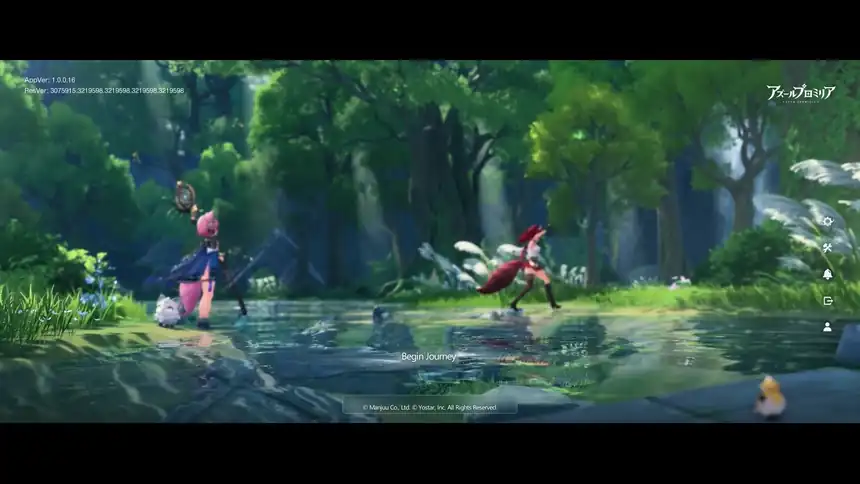
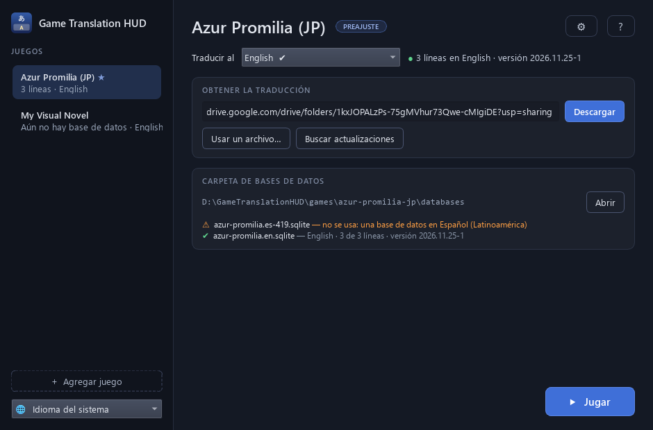
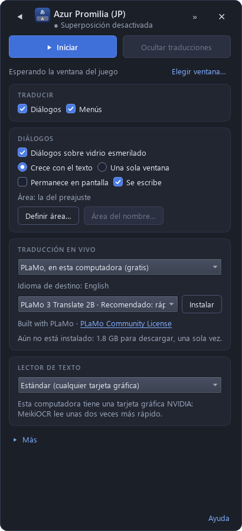

# Game Translation HUD

**Juega en tu idioma juegos en japonés.** Elige tu juego y el idioma en que lees,
consigue su base de datos de traducción y juega: el HUD lee el texto en la imagen del
juego, encuentra cada línea en la base de datos y dibuja la traducción donde estaba el
original. Nunca modifica el juego ni toca su memoria. (También funciona con juegos en chino
y coreano.)

*[Read in English](USER_GUIDE.md)*

Las imágenes muestran **Azur Promilia**, un juego para el que la app trae un preajuste.
Cualquier otro juego funciona igual; solo tienes que agregarlo.

  

**[⬇ Descarga la última versión](../../../releases/latest)** ·
Windows 10 (versión 2004) u 11 con una tarjeta gráfica DirectX 12, o Linux (X11, o
Wayland mediante XWayland) · el juego en modo ventana o sin bordes

---

## Lo que verás

- **Historia:** los diálogos aparecen sobre un suave vidrio esmerilado donde estaba el
  original, y la traducción se escribe al ritmo de la línea.
- **Menús:** las etiquetas y los nombres de objetos se pintan en su lugar, con los colores
  del propio juego. Los menús que ya viste vuelven a aparecer al instante.
- Una línea un poco atenuada es una traducción en vivo. El texto que no tiene ninguna base
  de datos se queda como está (salvo que la traducción en vivo esté activada).

## Primeros pasos

1. **Inicia la app.**
   - **Windows:** descomprime la descarga donde quieras, mantén la carpeta completa e
     inicia `GameTranslationHUD.exe`. Si Windows dice *"Windows protegió su PC"*, haz clic
     en **Más información** y luego en **Ejecutar de todas formas** (la app todavía no está
     firmada).
   - **Linux:** haz ejecutable el archivo `.AppImage` (`chmod +x`) e inícialo. En un
     escritorio Wayland la app funciona mediante XWayland, igual que los juegos en Wine o
     Proton.
2. **Pon el juego en modo ventana o sin bordes** desde sus propios ajustes. La pantalla
   completa exclusiva oculta cualquier superposición; la app te avisa si la detecta.
3. **Elige tu juego** en la ventana con la que se abre la app.
   - **Azur Promilia** tiene un **preajuste** (★): su ventana y sus áreas de diálogo y de
     menús ya están definidas, y sus bases de datos oficiales se descargan con un clic.
   - **Cualquier otro juego:** pulsa **+ Agregar juego**, ponle un nombre, elige su
     ventana (el juego debe estar abierto) y el idioma de su texto.
4. **Elige el idioma en que lees** debajo del nombre del juego (**Traducir al**). Los
   idiomas que tienen base de datos llevan ✔; los demás funcionan con la traducción en
   vivo.
5. **Consigue la base de datos** en ese idioma, en **Obtener la traducción**:
   - **Descargar** del enlace del juego (los preajustes ya traen uno), o pega un enlace que
     te hayan pasado: un archivo de base de datos, una carpeta compartida de Google Drive con
     bases de datos, o una lista de bases de datos (`index.json`). De una carpeta o una
     lista, la app toma la base de datos más reciente en tu idioma.
   - **Usar un archivo…** que ya tengas: la app lo revisa y, si aceptas, lo mueve a la
     carpeta de bases de datos del juego.
6. **Pulsa Jugar** y luego abre el juego. Se abre el HUD: un panel a un lado de la
   pantalla y la superposición, que espera a la ventana del juego y cubre su texto sola.
   **◀** en el panel te lleva de vuelta a tus juegos.

  

El idioma de la propia app sigue al de tu sistema; puedes elegir otro abajo a la izquierda
(🌐).

## Idiomas y la carpeta de bases de datos

Cada juego guarda sus bases de datos en una carpeta propia; la ventana de inicio muestra
dónde, y **Abrir** la abre. Cada base de datos indica a qué idioma traduce. **El HUD usa las
bases de datos del idioma en que lees**: una base de datos en otro idioma aparece como *no
se usa*, con el motivo. Una variante sirve para su idioma (una base de datos en español
latinoamericano se usa cuando lees español). Si dos bases de datos tienen la misma línea,
gana el archivo más reciente; tus traducciones en vivo van al final. Agrega o quita un
archivo de la carpeta y la app lo nota en dos segundos.

Un archivo que no es una base de datos de traducción (un texto, una descarga cortada, un
programa renombrado) **nunca se usa**: la ventana de inicio lo muestra con ⚠.

## El HUD

- **Iniciar / Detener** la superposición; **Ocultar traducciones** para ver el original.
- **Traducir:** **Diálogos** (diálogos, subtítulos, narración, opciones) y **Menús** (todo
  lo demás). ¿Solo quieres la historia? Desmarca Menús.
- **Diálogos:** **Diálogos sobre vidrio esmerilado** en el área de diálogo del juego
  (desactivado: se cubren donde están, como el resto del texto). El vidrio **crece con el
  texto** o es **una sola ventana**; puede **permanecer en pantalla**; la traducción **se
  escribe** al ritmo del juego o aparece completa.
- **Traducción en vivo:** el texto que no tiene ninguna base de datos, traducido en cuanto
  aparece ([más abajo](#traducción-en-vivo)).
- **Lector de texto:** el estándar, o MeikiOCR en una tarjeta NVIDIA
  ([más abajo](#el-lector-de-texto)).
- **Diagnóstico** aparece cuando se encuentra la ventana del juego: si el lector de texto
  usa la tarjeta gráfica, tiempos de lectura, menús recordados y un informe para copiar.
- **Más:** el lado del panel, su pestaña, los atajos de teclado, el modo de lectura
  (Equilibrado es el mejor para la mayoría de los juegos) y las líneas sin base de datos.

Pliega el panel con **»** o <kbd>Ctrl</kbd>+<kbd>Shift</kbd>+<kbd>F7</kbd>: queda una
pequeña pestaña en el borde de la pantalla; haz clic en ella para traer el panel de vuelta.

 

### El área de diálogo

El texto de la historia aparece sobre vidrio esmerilado en el área de diálogo del juego.
Los preajustes ya tienen sus áreas definidas. Para cualquier otro juego (un juego de RPG
Maker, una novela visual…) abre una conversación en el juego, pulsa **Definir área…** y
dibuja un recuadro sobre el cuadro de diálogo. **Área del nombre…** marca dónde aparece el
nombre de quien habla (opcional); **Restablecer** vuelve a las áreas del preajuste.

## Traducción en vivo

El texto que no tiene ninguna base de datos puede traducirse en cuanto aparece; sin base de
datos, se traduce todo lo que hay en pantalla. En **Traducción en vivo** elige:

- **PLaMo, en esta computadora**: gratis, y nada sale de tu computadora. Elige un tamaño
  (el modelo **2B** es una buena opción; **0.8B** para computadoras más modestas, **8B**
  para una tarjeta gráfica de 8 GB o más) y pulsa **Instalar**: lees y aceptas la licencia
  de PLaMo (debes tener 18 años o más, o el consentimiento de tu madre, padre o tutor), y
  luego el modelo y el programa que lo ejecuta se descargan una sola vez (de 0,6 a 5 GB) y
  se comprueban contra los archivos que publicó Preferred Networks. Funciona en la tarjeta gráfica cuando puede y recibe la
  conversación hasta ahora y los nombres del juego con cada línea, así que una línea tarda
  alrededor de una décima de segundo. PLaMo escribe unos 50 idiomas, entre ellos inglés y
  español (no portugués). Built with PLaMo, bajo la
  [PLaMo Community License](https://plamo.preferredai.jp/info/plamo-community-license-en).
- **Claude** o **ChatGPT** con tu propia clave de API: pégala, pulsa **Guardar** y luego
  **Probar**, y elige el modelo (ChatGPT muestra los que tu clave puede usar después de una
  prueba). Le pagas a Anthropic o a OpenAI lo que uses.

Las líneas en vivo se ven un poco atenuadas y se guardan (por idioma), así que la próxima
vez aparecen al instante. Solo se envía texto, nunca imágenes, y PLaMo no envía nada.

## El lector de texto

- **Estándar (cualquier tarjeta gráfica):** viene con la app y funciona en cualquier
  tarjeta gráfica con DirectX 12, o en el procesador.
- **MeikiOCR (NVIDIA, más rápido):** un lector hecho para el texto de juegos en japonés,
  unas dos veces más rápido, así que las traducciones siguen mejor a la pantalla. Necesita
  una tarjeta gráfica NVIDIA (en cualquier otra aparece desactivado) y una descarga única
  de unos 1,9 GB: las bibliotecas CUDA de NVIDIA y el lector. Elígelo y pulsa
  **Instalar**: la app dice qué descarga y de dónde, y pregunta antes. La superposición se
  reinicia con el nuevo lector. Un juego que no está en japonés usa el lector estándar.

## Líneas sin base de datos

Mientras juegas, el HUD anota las líneas que ninguna base de datos tenía (solo en tu
computadora; puedes desactivarlo en **Más**). **Más → Abrir carpeta** las muestra. Así es
como mejora una base de datos: envíaselas a quien hace la base de datos del juego.

## Compartir bases de datos

Una base de datos es un archivo `.sqlite`. Compártelo como archivo, o pon las bases de
datos en una carpeta de Google Drive compartida con *Cualquier persona con el enlace*
(*Lector*) y pasa el enlace de la carpeta: cada jugador recibe la base de datos más
reciente en el idioma en que lee, siempre que los archivos conserven nombres como
`juego.es-419.2026.11.25.1.sqlite` (una versión más nueva es un archivo nuevo en la misma
carpeta). También funcionan una lista de bases de datos (`index.json`), Dropbox, OneDrive,
GitHub y enlaces directos.

**Usa solo enlaces de personas en quienes confíes.** La app es cuidadosa con lo que entra:
pregunta antes de descargar (*Hay una base de datos más nueva*), revisa cada archivo (una
base de datos SQLite de traducción de 1 GB como máximo que se lee sin daños; un archivo de
una lista debe coincidir con la suma de verificación que indica la lista), copia solo su
texto y sus números a una base de datos propia (nada de una base de datos se ejecuta
nunca) y guarda la que reemplaza en la carpeta `backups` del juego.

## Mientras juegas

| Teclas | Qué hacen |
|---|---|
| <kbd>Ctrl</kbd>+<kbd>Shift</kbd>+<kbd>F8</kbd> | Ocultar o mostrar las traducciones |
| <kbd>Ctrl</kbd>+<kbd>Shift</kbd>+<kbd>F7</kbd> | Plegar el panel o traerlo de vuelta |
| <kbd>Ctrl</kbd>+<kbd>Shift</kbd>+<kbd>F9</kbd> | Detener la superposición |

Los atajos funcionan mientras el juego tiene el foco. Cámbialos en **Más**: haz clic en uno
y pulsa las nuevas teclas.

El punto bajo el nombre del juego muestra el estado de la superposición: **verde**
activada, **amarillo** iniciando, esperando al juego o traducciones ocultas, **gris**
desactivada, **naranja** algo impide que funcione (el Diagnóstico dice qué).

## Cómo funciona

1. **Mira.** El HUD captura la imagen del juego unas 30 veces por segundo. Nunca ve su
   propia superposición ni el panel.
2. **Lee.** Un lector de texto en tu tarjeta gráfica (en Linux, el procesador) lee las
   partes de la imagen que cambiaron, primero los diálogos; MeikiOCR en una tarjeta NVIDIA
   lo hace en la mitad del tiempo.
3. **Busca.** Cada línea se encuentra en la base de datos, aunque se lea mal un carácter o
   dos o la línea todavía se esté escribiendo.
4. **Cubre.** La traducción se dibuja sobre vidrio esmerilado en los diálogos y se pinta
   en su lugar en los menús. Desaparece en cuanto desaparece el original.

Las traducciones se hacen de antemano, en el orden de la historia y con los nombres y
términos del juego como contexto. Por eso los diálogos aparecen en una fracción de segundo.

## Si algo no funciona

- **No aparece nada sobre el juego.** ¿Se encontró la ventana del juego (se muestra bajo
  Iniciar)? El juego debe estar en modo ventana o sin bordes y no minimizado; **Elegir
  ventana…** le indica a la app cuál es.
- **El punto está naranja.** Abre el **Diagnóstico**: indica la causa (pantalla completa
  exclusiva, una imagen que no se puede capturar o queda en negro, un lector que falló).
- **El Diagnóstico dice CPU.** Leer con el procesador es lento. Pulsa **Probar la GPU de
  nuevo**; si sigue en la CPU, actualizar el controlador gráfico suele ayudar.
- **Las traducciones parpadean o llegan tarde.** Deja **Equilibrado** en Más → Lectura
  (una etiqueta de menú se lee dos veces antes de cubrirla); elige **Instantáneo** si se
  pierden líneas cortas.
- **Un atajo no hace nada.** Otro programa lo usa: elige otras teclas en **Más**.
- **Algún texto queda sin traducir.** Todavía no está en tu base de datos: activa la
  traducción en vivo o busca una base de datos más nueva.
- **Linux:** el HUD lee ventanas de programas X11 (los juegos en Wine y Proton funcionan
  mediante XWayland por defecto). La superposición necesita un escritorio con composición
  (GNOME, KDE Plasma, Xfce con la composición activada): sin ella, sus partes
  transparentes se ven negras. En un escritorio sin bandeja del sistema (GNOME), usa la
  pestaña del panel o el atajo.
- **Empezar de cero.** Tus ajustes, bases de datos y registros están en
  `%LOCALAPPDATA%\GameTranslationHUD` (Windows) o `~/.local/share/GameTranslationHUD`
  (Linux). Cierra la app y borra esa carpeta.

---

Game Translation HUD lee la pantalla y dibuja su propia ventana. No modifica el juego, no
toca su memoria, no se engancha a su proceso ni le envía pulsaciones. Úsalo bajo tu propio
criterio: los
términos de servicio de un juego pueden decir algo sobre herramientas de terceros. Qué
envía la app y adónde: [PRIVACY.md](../PRIVACY.md).

Uso libre, [licencia MIT](../LICENSE). El software que incluye conserva sus propias
licencias (ver `THIRD_PARTY_NOTICES.txt` en la descarga); PLaMo y llama.cpp, que se
descargan al instalarlos, conservan las suyas. Imágenes del juego: beta cerrada de Azur
Promilia, del stream de RiverV Workshop.
