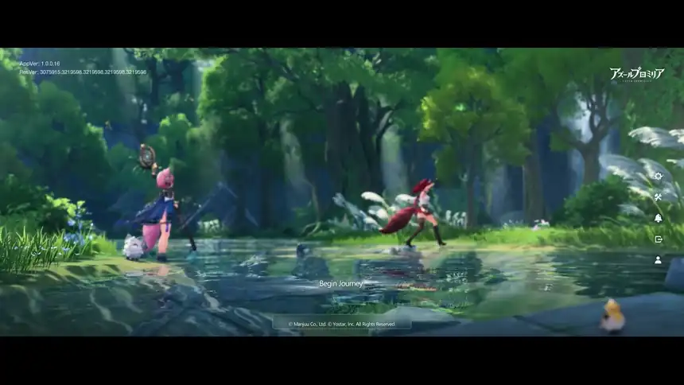
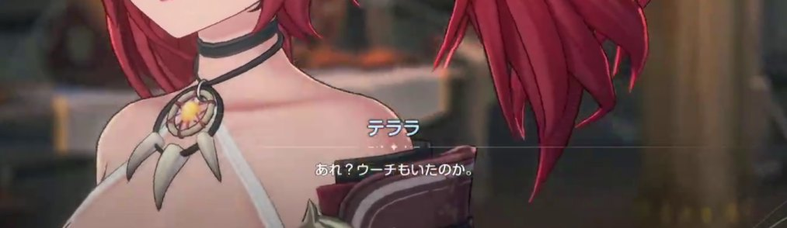
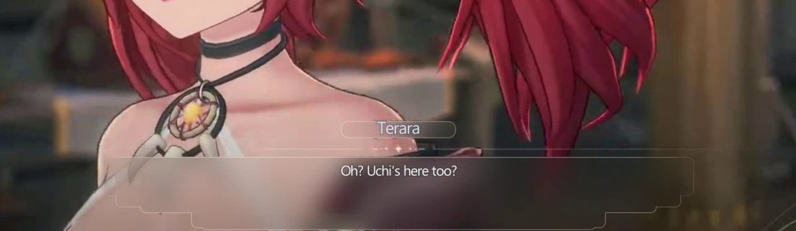
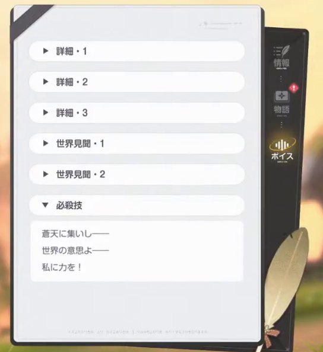
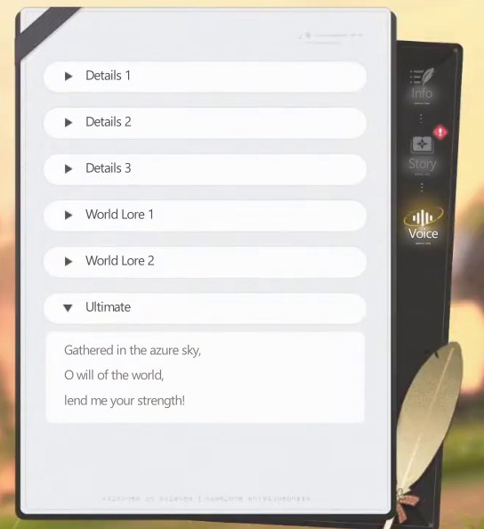
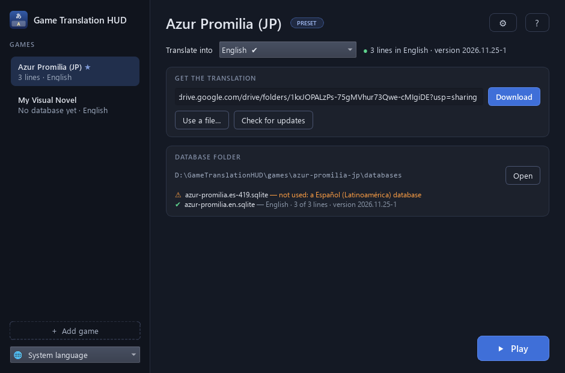
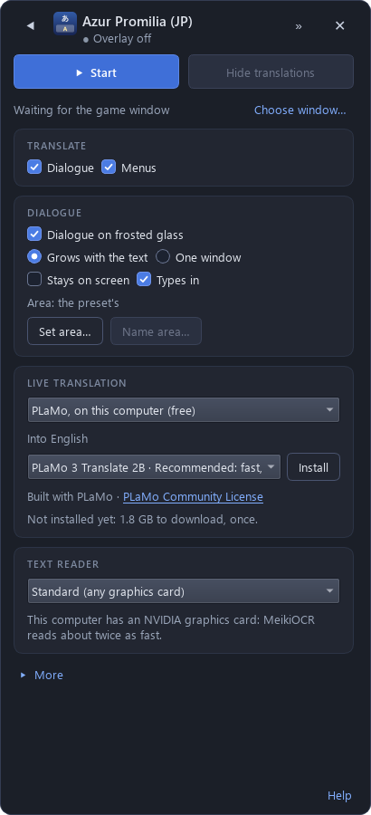

# Game Translation HUD

**Play Japanese games in your language.** Pick your game and the language you read, get
its translation database, and play: the HUD reads the text in the game's picture, finds
each line in the database and draws the translation where the original was. It never
changes the game or touches its memory. (Chinese and Korean games work too.)

*[Leer en español](USER_GUIDE.es.md)*

The pictures show **Azur Promilia**, a game the app has a built-in preset for. Every other
game works the same way; you add it yourself.

  

**[⬇ Download the latest version](../../../releases/latest)** ·
Windows 10 (version 2004) or 11 with a DirectX 12 graphics card, or Linux (X11, or Wayland
through XWayland) · the game in windowed or borderless mode

---

## What you'll see

| Original | With the HUD |
|:---:|:---:|
|  |  |
|  |  |

- **Story:** dialogue sits on soft frosted glass where the original was, and the
  translation types out with the line.
- **Menus:** labels and item names are painted over in place, in the game's own colours.
  Menus you have seen before come back instantly.
- A slightly faded line is a live translation. Text no database has stays as it is
  (unless live translation is on).

## Set up

1. **Start the app.**
   - **Windows:** unzip the download anywhere, keep the folder together, and start
     `GameTranslationHUD.exe`. If Windows says *"Windows protected your PC"*, click
     **More info**, then **Run anyway** (the app isn't code-signed yet).
   - **Linux:** make the `.AppImage` executable (`chmod +x`) and start it. On a Wayland
     desktop the app runs through XWayland, like games under Wine or Proton do.
2. **Set the game to windowed or borderless** in its own settings. Exclusive full screen
   hides every overlay; the app says so if it detects it.
3. **Choose your game** in the window the app opens with.
   - **Azur Promilia** is a built-in **preset** (★): its window, dialogue and menu areas
     are set, and its official databases download with one click.
   - **Any other game:** press **+ Add game**, give it a name, choose its window (the game
     must be open) and the language its text is in.
4. **Choose the language you read** under the game's name (**Translate into**). Languages
   with a database are marked ✔; every other language works through live translation.
5. **Get the database** in that language, under **Get the translation**:
   - **Download** from the game's link (presets have one), or paste a link someone gave
     you: a database file, a shared Google Drive folder of databases, or a list of
     databases (`index.json`). From a folder or a list the app takes the newest database in
     your language.
   - **Use a file…** you already have: the app checks it and, once you say yes, moves it
     into the game's database folder.
6. **Press Play**, then start the game. The HUD opens: a panel on the side of the screen,
   and the overlay, which waits for the game window and covers its text on its own. **◀**
   on the panel goes back to your games.

  

The app's own language follows your system; choose another at the bottom left (🌐).

## Languages and the database folder

Each game keeps its databases in a folder of its own; the start window shows where, and
**Open** opens it. A database says which language it translates into. **The HUD uses the
databases in the language you read**: a database in another language is listed as *not
used*, with why. A variant serves its language (a Latin American Spanish database is used
when you read Spanish). Where two databases have the same line, the newest file wins; your
live translations come last. Drop a file in or take one out, and the app notices within two
seconds.

A file that isn't a translation database (a text file, a download cut off, a renamed
program) is **never used**: the start window lists it with a ⚠.

## The HUD

- **Start / Stop** the overlay; **Hide translations** for a look at the original.
- **Translate:** **Dialogue** (dialogue, subtitles, narration, choices) and **Menus**
  (everything else). Only want the story? Untick Menus. **Text size** makes every
  translation smaller or larger than the game's own text (smaller text is squeezed less
  when the English is long), and **White text** draws it all white with a black outline
  instead of in the game's colours.
- **Dialogue:** **Dialogue on frosted glass** in the game's dialogue area (off: covered
  where it is, like other text). The glass **grows with the text** or is **one window**;
  it can **stay on screen**; the translation **types in** with the game's text or appears
  whole.
- **Live translation:** text no database has, translated as it appears
  ([below](#live-translation)).
- **Text reader:** the standard one, or MeikiOCR on an NVIDIA card
  ([below](#the-text-reader)).
- **Diagnostics** appears once the game window is found: whether the text reader runs on
  the graphics card, reading times, remembered menus, and a report to copy.
- **Streaming (OBS):** the translations for your stream ([below](#streaming)).
- **More:** the panel's side, its handle, the hotkeys, the reading mode (Balanced is best
  for most games), and the list of lines no database had.

Fold the panel away with **»** or <kbd>Ctrl</kbd>+<kbd>Shift</kbd>+<kbd>F7</kbd>: a small
handle stays on the screen's edge; click it to bring the panel back.

 

### The dialogue area

Story text gets frosted glass in the game's dialogue area. Presets have their areas set.
For any other game (an RPG Maker game, a visual novel…) open a conversation in the game
and press **Set area…**, then drag a box over the dialogue box. **Name area…** marks where
the speaker's name is (optional); **Reset** goes back to the preset's areas.

## Live translation

Text no database has can be translated as it appears; with no database at all, everything
on screen is. Under **Live translation** choose:

- **PLaMo, on this computer**: free, and nothing leaves your computer. Choose a size (the
  **2B** model is a good default; **0.8B** for weaker computers, **8B** for a graphics card
  with 8 GB or more) and press **Install**: you read and accept PLaMo's license (you must
  be 18 or older, or have a parent's or guardian's consent), then the model and the program
  that runs it download once (0.6 to 5 GB), checked against the files Preferred Networks
  published.
  It runs on the graphics card when it can, and gets the conversation so far and the
  game's names with every line, so a line takes about a tenth of a second. PLaMo writes
  about 50 languages, among them English and Spanish (not Portuguese). Built with PLaMo,
  under the [PLaMo Community License](https://plamo.preferredai.jp/info/plamo-community-license-en).
- **Claude** or **ChatGPT** with your own API key: paste it, press **Save**, then **Test**,
  and choose the model (ChatGPT lists those your key can use after a test). You pay
  Anthropic or OpenAI for what you use.
- **DeepL** with your own API key (the free plan translates 500,000 characters a month).
  The game's names are kept as the database has them, and the last lines of the
  conversation are sent along as context.
- **Another model**: any model behind a server that speaks OpenAI's API. That can be one
  you run yourself (Ollama, LM Studio, llama.cpp, KoboldCpp) or a service (OpenRouter,
  Google Gemini, DeepSeek, Groq, Mistral…). Nothing is installed for it. Type the
  server's address, or pick one under **Servers**, add a key if the server asks for one,
  and press **Test**: it lists the server's models. Choose one, or type its name. It gets
  the same instructions, names and conversation as Claude and ChatGPT. Small models
  translate worse, and a server on your own computer shares the graphics card with the
  game.

Live lines show slightly faded and are kept (per language), so next time they appear at
once. Only text is sent, never pictures, and PLaMo sends nothing at all.

## Streaming

The overlay is kept out of every screen capture, so the HUD never reads its own
translations. That also keeps it out of OBS. To show the translations on stream, open
**Streaming (OBS)** and tick **Show the translations to OBS**. The app then serves a page
on this computer only (`http://127.0.0.1:47811/`) with the translations on a clear
background. In OBS:

1. Capture the game as usual, with **Game Capture** or **Window Capture**.
2. Add a **Browser** source with the address shown (**Copy** puts it on the clipboard).
   Set its width and height to the size of the game's picture: the panel shows it once the
   overlay runs (for example 1920 × 1080).
3. Put the Browser source above the game capture, at the same place and size.

The game keeps OBS's full frame rate, and the translations sit where you see them.
Nothing leaves your computer. On Linux, OBS's screen capture shows the overlay already.

## The text reader

- **Standard (any graphics card):** comes with the app and runs on any DirectX 12 graphics
  card, or the processor.
- **MeikiOCR (NVIDIA, faster):** a reader made for Japanese game text, about twice as fast,
  so translations follow the screen more closely. It needs an NVIDIA graphics card (on any
  other card it's greyed out) and a one-time download of about 1.9 GB: NVIDIA's CUDA
  libraries and the reader. Choose it and press **Install**; the app says what it
  downloads from where and asks first. The overlay restarts with the new reader. A game
  that isn't Japanese uses the standard reader.

## Lines no database has

While you play, the HUD writes down the lines no database had (on your computer only; you
can switch it off under **More**). **More → Open folder** shows them. They are how a
database gets better: send them to whoever makes the game's database.

## Sharing databases

A database is one `.sqlite` file. Share it as a file, or put the databases in a Google
Drive folder shared with *Anyone with the link* (*Viewer*) and give players the folder's
link: each player gets the newest database in the language they read, as long as the files
keep names like `game.en.2026.11.25.1.sqlite` (a newer version is a new file in the same
folder). A list of databases (`index.json`), Dropbox, OneDrive, GitHub and direct links
work too.

**Only use links from people you trust.** The app is careful with what comes in: it asks
before downloading anything (*A newer database is available*), checks every file (an
SQLite translation database of at most 1 GB that reads back without damage; a file from an
`index.json` must match the checksum it gives), copies only its text and numbers into a
database of its own (nothing in a database ever runs), and keeps the one it replaces in
the game's `backups` folder.

## While you play

| Keys | What they do |
|---|---|
| <kbd>Ctrl</kbd>+<kbd>Shift</kbd>+<kbd>F8</kbd> | Hide or show the translations |
| <kbd>Ctrl</kbd>+<kbd>Shift</kbd>+<kbd>F7</kbd> | Fold the panel away, or bring it back |
| <kbd>Ctrl</kbd>+<kbd>Shift</kbd>+<kbd>F9</kbd> | Stop the overlay |

The keys work while the game has the focus. Change them under **More**: click one and
press the new keys.

The dot under the game's name shows the overlay's state: **green** on, **yellow**
starting, waiting for the game or translations hidden, **grey** off, **orange** something
keeps it from working (Diagnostics says what).

## How it works

1. **Look.** The HUD captures the game's picture about 30 times a second. It never sees
   its own overlay or the panel.
2. **Read.** A text reader on your graphics card (on Linux, the processor) reads the
   parts of the picture that changed, dialogue first; MeikiOCR on an NVIDIA card does it
   in about half the time.
3. **Look up.** Every line is found in the database, even when a character or two is
   misread or the line is still typing out.
4. **Cover.** The translation is drawn on frosted glass for dialogue and painted in place
   for menus. It goes the moment the original goes.

The translations are made ahead of time, in story order with the game's names and terms as
context. That's why dialogue appears within a fraction of a second.

## If something's off

- **Nothing appears over the game.** Is the game window found (shown under Start)? The
  game must be in windowed or borderless mode and not minimised; **Choose window…** points
  the app at it.
- **The dot is orange.** Open **Diagnostics**: it names the cause (exclusive full screen,
  a picture that can't be captured or stays black, a reader that failed).
- **Diagnostics says CPU.** Reading on the processor is slow. Press **Try the GPU again**;
  if it stays on the CPU, updating the graphics driver usually helps.
- **Translations flicker or arrive late.** Keep **Balanced** under More → Reading (a
  menu label is read twice before it's covered); choose **Instant** if short lines are
  missed.
- **A hotkey does nothing.** Another program has it: choose other keys under **More**.
- **Some text stays untranslated.** It isn't in your database yet: switch on live
  translation, or check for a newer database.
- **Linux:** the HUD reads windows of X11 programs (games under Wine and Proton run
  through XWayland by default). The overlay needs a compositing desktop (GNOME, KDE
  Plasma, Xfce with compositing on): without one, its see-through parts show black. On a
  desktop without a tray (GNOME), use the panel's handle or the hotkey.
- **Start over.** Your settings, databases and logs are in `%LOCALAPPDATA%\GameTranslationHUD`
  (Windows) or `~/.local/share/GameTranslationHUD` (Linux). Close the app and delete
  that folder.

---

Game Translation HUD reads the screen and draws its own window. It doesn't modify the
game, touch its memory, hook the process or send it input. Use it at your own discretion:
a game's terms of service
may still say something about third-party tools. What the app sends where:
[PRIVACY.md](../PRIVACY.md).

Free to use, [MIT licence](../LICENSE). The software it bundles keeps its own licences (see
`THIRD_PARTY_NOTICES.txt` in the download); PLaMo and llama.cpp, downloaded when you install
them, keep theirs. Game pictures: Azur Promilia closed beta, from the RiverV Workshop
stream.
